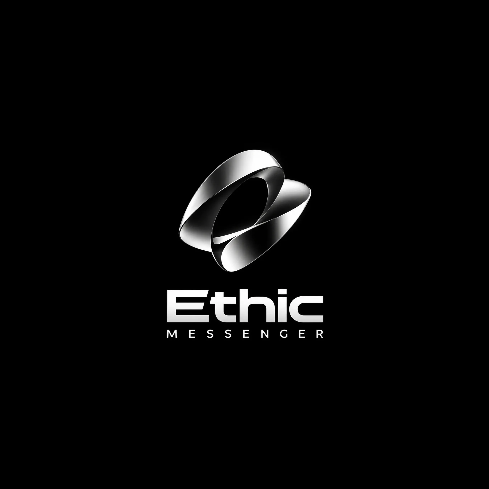

  

# Ethic Messenger — приложения для Android и iOS

Мобильные приложения мессенджера **Ethic Messenger**: чаты, голосовые сообщения, фото и файлы,
аудио- и видеозвонки, демонстрация экрана (на компьютере), шумоподавление.

Приложение — нативная оболочка ([Capacitor](https://capacitorjs.com)) над веб-версией Ethic,
поэтому дизайн и все функции всегда совпадают с сайтом, а обновления сайта сразу появляются в приложении.

## Установка

Готовые файлы — во вкладке **[Releases](../../releases/latest)**.

### Android
1. Скачайте `Ethic-Messenger.apk`.
2. Откройте файл и разрешите установку из этого источника.
3. При первом звонке разрешите доступ к микрофону и камере.

### iPhone / iPad
1. Скачайте `Ethic-Messenger.ipa`.
2. Установите через [Sideloadly](https://sideloadly.io) или [AltStore](https://altstore.io) со своим Apple ID.
3. С бесплатным Apple ID приложение работает 7 дней — потом переподпишите его в той же программе.

## Сборка

Сборка идёт автоматически в GitHub Actions (`.github/workflows/build.yml`):

- **Android** — Ubuntu, подпись ключом из секретов репозитория;
- **iOS** — macOS, неподписанный `.ipa`;
- оба файла выкладываются в релиз.

Запустить вручную: вкладка **Actions → Сборка приложений → Run workflow**, указать версию.
Или отправить тег: `git tag v1.0.1 && git push --tags`.

Секреты для подписи Android: `ANDROID_KEYSTORE_BASE64`, `ANDROID_KEYSTORE_PASSWORD`,
`ANDROID_KEY_ALIAS`, `ANDROID_KEY_PASSWORD`.

## Структура

| Путь | Что это |
| --- | --- |
| `capacitor.config.json` | Название, ID приложения, адрес сервера |
| `assets/` | Логотип, иконки и заставка (генерируются `npm run icons`) |
| `scripts/patch-android.mjs` | Разрешения микрофона/камеры и версия для Android |
| `scripts/patch-ios.mjs` | Описания доступа к микрофону/камере/фото для iOS |
| `www/offline.html` | Экран «Нет подключения» |
